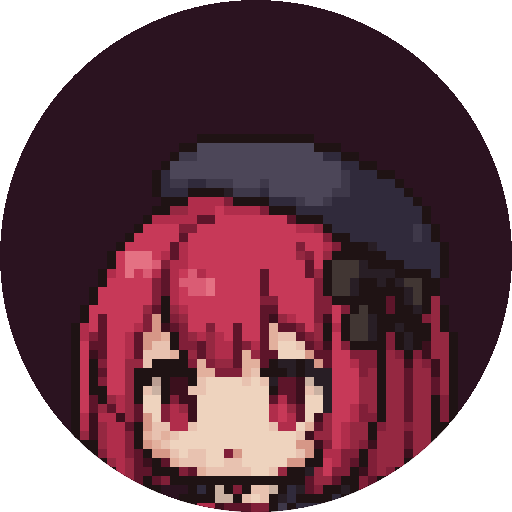
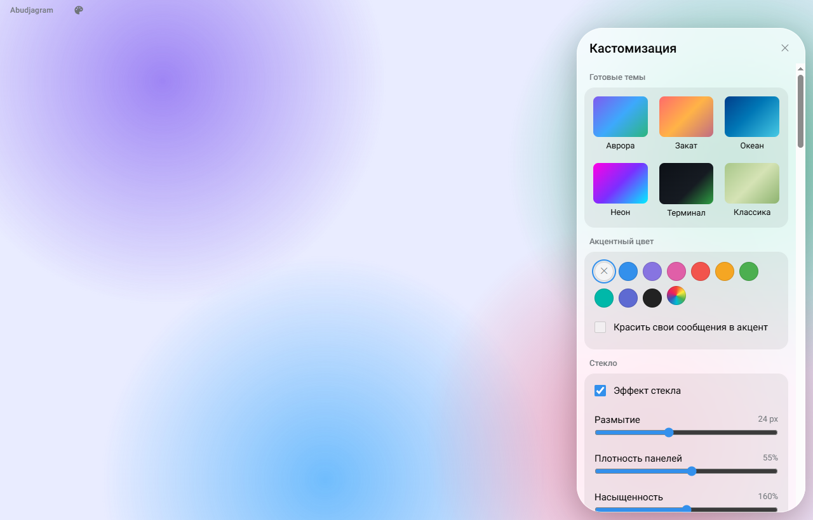
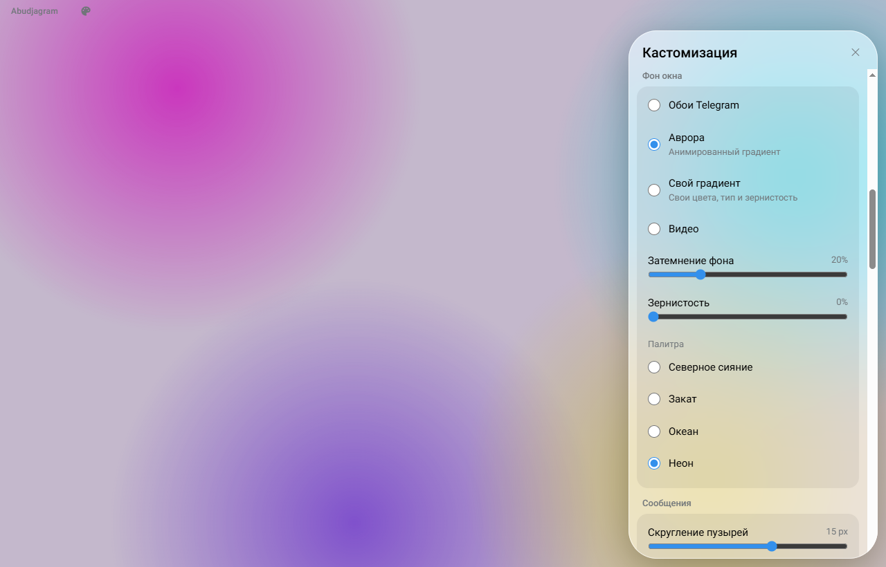

# Abudjagram

**Telegram для Windows, который выглядит так, как хотите вы.**

Стекло, живые фоны, свои цвета и шрифты — поверх официального Telegram Web, без ключей и танцев с бубном.

[**Скачать для Windows**](https://github.com/omigros/abudjagram/releases/latest) · [Риски](#риски-и-безопасность) · [Для разработчиков](docs/DEVELOPMENT.md)

> [!WARNING]
> **Abudjagram на ранней стадии разработки.** Он работает, но в нём возможны ошибки, а интерфейс и настройки
> ещё будут меняться. Это неофициальный клиент, он не связан с Telegram. Прочитайте раздел
> [«Риски и безопасность»](#риски-и-безопасность) перед установкой.

## Как выглядит

  
  

## Что умеет

- **Стекло** — полупрозрачные панели с размытием: сила размытия, плотность, насыщенность, светлая кромка, свой оттенок.
- **Живые фоны** — анимированная «Аврора» в четырёх палитрах, свой градиент из 2–4 цветов с зернистостью,
  видео (файл или ссылка), системные Mica и Acrylic на Windows 11.
- **Прозрачное окно** — сквозь фон приложения виден рабочий стол.
- **Цвета** — акцентный цвет для кнопок, ссылок и ваших сообщений.
- **Сообщения и шрифты** — скругление пузырей, хвостики, шрифты Inter, Manrope, Nunito, JetBrains Mono или любой
  установленный, масштаб интерфейса.
- **Анимации** — скорость, характер движения, эффекты появления сообщений.
- **Свой CSS** — для тех, кому мало настроек.
- **Готовые темы** в один клик, экспорт и импорт настроек в файл.
- **Как настоящее приложение** — свой заголовок окна, трей, счётчик непрочитанных на значке, автозапуск, выбор значка
  приложения и значка в трее.

## Как скачать и установить

1. Откройте страницу [**последней версии**](https://github.com/omigros/abudjagram/releases/latest).
2. В разделе **Assets** скачайте файл **`Abudjagram-Setup-….exe`**.
3. Запустите его. Windows может показать окно **«Windows защитила ваш компьютер»** — так бывает с программами без
   платной цифровой подписи. Нажмите **«Подробнее» → «Выполнить в любом случае»**.
4. Выберите папку и завершите установку. Ярлык появится на рабочем столе и в меню «Пуск».
5. Откройте Abudjagram и войдите в Telegram как обычно: по QR-коду
   (Telegram на телефоне → **Настройки → Устройства → Подключить устройство**) или по номеру телефона.
6. Нажмите на **палитру** в заголовке окна (или **Ctrl+Shift+K**) — и настраивайте.

**Обновление.** Автообновления пока нет. Скачайте новую версию и установите поверх старой — вход и настройки
сохранятся.

**Удаление.** «Параметры Windows» → «Приложения» → Abudjagram → «Удалить».

**Требования:** Windows 10 или 11, 64-бит, около 500 МБ места.

## Риски и безопасность

Пожалуйста, прочитайте — здесь честно о том, чем Abudjagram отличается от официального приложения.

- **Неофициальный клиент.** Abudjagram сделан энтузиастами и не связан с Telegram FZ-LLC. Telegram не проверял
  его и не отвечает за его работу.
- **Ваш аккаунт.** По умолчанию Abudjagram загружает **официальный** Telegram Web (web.telegram.org) и только меняет
  его внешний вид. Ваши сообщения и вход идут напрямую в Telegram, как в браузере. Нам не известны случаи
  ограничения аккаунтов из-за такого использования, но гарантировать этого мы не можем: Telegram сам решает, как относиться
  к неофициальным клиентам.
- **Режим «Своя сборка»** работает через собственные ключи API с my.telegram.org. Он для опытных пользователей:
  использование ключей регулируется [условиями Telegram API](https://core.telegram.org/api/terms). Не используйте
  чужие ключи.
- **Данные.** Abudjagram ничего не собирает и никуда не отправляет. Сессия и настройки хранятся только на вашем
  компьютере, в папке `%APPDATA%\Abudjagram`.
- **Установщик без подписи.** Поэтому Windows и некоторые антивирусы предупреждают о нём. Скачивайте Abudjagram
  только со [страницы релизов](https://github.com/omigros/abudjagram/releases) этого репозитория: там установщик
  собирается автоматически из открытого кода.
- **Свой CSS.** Вставляйте только CSS, которому доверяете: чужой код может испортить вид или подгружать что-то
  из интернета.
- **Без гарантий.** Это ранняя версия, она распространяется «как есть», без каких-либо гарантий (см. лицензию).
  Возможны ошибки, сбои и изменения настроек между версиями.

Нашли ошибку или есть идея? Создайте [issue](https://github.com/omigros/abudjagram/issues).

## Лицензия и благодарности

Abudjagram основан на [Telegram Web A](https://github.com/Ajaxy/telegram-tt) — открытом веб-клиенте Telegram
(© Alexander Zinchuk и участники проекта) — и, как и он, распространяется по лицензии
[GPL-3.0](LICENSE). Исходный код Abudjagram открыт в этом репозитории. Описание оригинального проекта —
в [docs/TELEGRAM_WEB_A.md](docs/TELEGRAM_WEB_A.md).

«Telegram» — товарный знак его владельцев; в этом проекте он упоминается только для описания совместимости.
